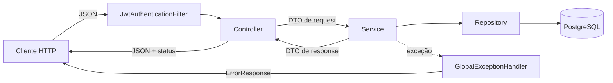

# 01 — Arquitetura

## MVC simplificado para API REST

Em uma API REST não há telas; a "View" é a **representação JSON** devolvida ao cliente.
O projeto usa três camadas, cada uma com uma responsabilidade:

| Camada | Pacote | Responsabilidade | Não deve |
|---|---|---|---|
| **Controller** | `controller` | Receber HTTP, validar o DTO (`@Valid`), chamar o service, escolher o status (`ResponseEntity`) | Conter regra de negócio ou acessar repository |
| **Service** | `service` | Regras de negócio, transações (`@Transactional`), conversão entidade ↔ DTO, lançar exceções de negócio | Conhecer `HttpServletRequest`/`ResponseEntity` |
| **Model** | `model` + `repository` | Entidades JPA (tabelas) e acesso a dados (Spring Data) | Ser devolvida diretamente na resposta |
| **View** | `dto` | Records de request/response — o formato JSON do contrato | Ter lógica |



### Regras

1. Controller → Service → Repository. Nunca pular camada.
2. Entidades JPA **nunca** saem do service; o controller só vê DTOs (evita vazar `password`
   e loops de serialização em relacionamentos).
3. Erros de negócio são **exceções** (`NotFoundException`, `BadRequestException`) lançadas no
   service e convertidas em JSON pelo `GlobalExceptionHandler` (spec 05). Controller não tem `try/catch`.
4. Toda operação de escrita no service é `@Transactional`; leituras usam `@Transactional(readOnly = true)`.
5. Configuração vem de `application.yml` + variáveis de ambiente — nada de senha ou segredo no código.

## Estrutura de diretórios

Equivalente Java da estrutura pedida no enunciado (`config/`, `controllers/`, `middleware/`,
`models/`, `routes/`, `services/`). Em Spring, as rotas ficam nas anotações dos controllers
e o "middleware" corresponde aos filtros de `security/`.

```
projeto-backend/
├── src/
│   ├── main/
│   │   ├── java/br/com/digitalstore/api/
│   │   │   ├── DigitalStoreApiApplication.java    # equivalente a server.js
│   │   │   ├── config/
│   │   │   │   ├── SecurityConfig.java          # rotas públicas/protegidas
│   │   │   │   ├── OpenApiConfig.java           # Swagger + esquema Bearer
│   │   │   │   └── WebConfig.java               # serve /media/** (imagens)
│   │   │   ├── controller/
│   │   │   │   ├── UserController.java
│   │   │   │   ├── AuthController.java          # POST /v1/user/token
│   │   │   │   ├── CategoryController.java
│   │   │   │   └── ProductController.java
│   │   │   ├── dto/
│   │   │   │   ├── common/   PageResponse.java, ErrorResponse.java
│   │   │   │   ├── user/     UserCreateRequest, UserUpdateRequest, UserResponse,
│   │   │   │   │             TokenRequest, TokenResponse
│   │   │   │   ├── category/ CategoryRequest, CategoryResponse
│   │   │   │   └── product/  ProductCreateRequest, ProductUpdateRequest, ProductResponse,
│   │   │   │                 ImageRequest, ImageResponse, OptionRequest, OptionResponse
│   │   │   ├── exception/
│   │   │   │   ├── GlobalExceptionHandler.java  # @RestControllerAdvice
│   │   │   │   ├── NotFoundException.java
│   │   │   │   └── BadRequestException.java
│   │   │   ├── model/
│   │   │   │   ├── User.java, Category.java, Product.java,
│   │   │   │   ├── ProductImage.java, ProductOption.java
│   │   │   │   └── enums/ OptionShape.java, OptionType.java (+ converters)
│   │   │   ├── repository/
│   │   │   │   ├── UserRepository.java, CategoryRepository.java,
│   │   │   │   ├── ProductRepository.java       # JpaSpecificationExecutor
│   │   │   │   └── spec/ProductSpecifications.java  # filtros da busca
│   │   │   ├── security/                        # equivalente a middleware/
│   │   │   │   ├── JwtService.java
│   │   │   │   ├── JwtAuthenticationFilter.java
│   │   │   │   └── JsonAuthenticationEntryPoint.java
│   │   │   ├── service/
│   │   │   │   ├── UserService.java, AuthService.java,
│   │   │   │   ├── CategoryService.java, ProductService.java
│   │   │   │   └── ImageStorageService.java     # base64 → arquivo em disco
│   │   │   └── util/
│   │   │       ├── FieldSelector.java           # implementa ?fields=
│   │   │       └── SearchParams.java            # parse/validação de limit/page
│   │   └── resources/
│   │       ├── application.yml
│   │       └── db/migration/                    # V1__...sql a V6__...sql (spec 03)
│   └── test/java/br/com/digitalstore/api/               # spec 09
├── uploads/                                     # imagens (fora do git)
├── docs/ENUNCIADO.md                            # cópia do README original
├── specs/                                       # estas specs
├── Dockerfile
├── docker-compose.yml
├── .env.example
├── .dockerignore
├── .gitignore
├── pom.xml
├── mvnw / mvnw.cmd
└── README.md                                    # guia de setup (spec 10)
```

> O enunciado original está em `docs/ENUNCIADO.md`; o `README.md` da raiz deve ser o guia de setup.

## Convenções

| Item | Convenção | Exemplo |
|---|---|---|
| Pacote raiz | `br.com.digitalstore.api` | — |
| DTO de entrada | `<Recurso><Ação>Request` (record) | `UserCreateRequest` |
| DTO de saída | `<Recurso>Response` (record) | `ProductResponse` |
| Conversão | método estático no DTO de resposta | `UserResponse.from(user)` |
| JSON | snake_case global (`spring.jackson.property-naming-strategy: SNAKE_CASE`) | `priceWithDiscount` → `price_with_discount` |
| Exceção ao snake_case | `@JsonProperty("confirmPassword")` | — |
| Ids | `Integer` (coluna `INTEGER` do enunciado) | — |
| Mensagens de erro | Português | "O campo email é obrigatório" |
| Comentários | Javadoc em toda classe e em todo método público de service/controller | critério "código comentado" |

Exemplo de DTO:

```java
/** Payload de cadastro de usuário (POST /v1/user). */
public record UserCreateRequest(
        @NotBlank(message = "O campo firstname é obrigatório") String firstname,
        @NotBlank(message = "O campo surname é obrigatório") String surname,
        @NotBlank @Email(message = "E-mail inválido") String email,
        @NotBlank @Size(min = 6, message = "A senha deve ter ao menos 6 caracteres") String password,
        @NotBlank @JsonProperty("confirmPassword") String confirmPassword
) {}
```

## Dependências (`pom.xml`)

Gerar no Spring Initializr com: **Spring Web, Spring Data JPA, Validation, Spring Security,
PostgreSQL Driver, Flyway Migration, Spring Boot DevTools, Lombok (opcional), Testcontainers**.
Depois adicionar manualmente:

```xml
<!-- Flyway 10+ exige o módulo específico do banco -->
<dependency>
    <groupId>org.flywaydb</groupId>
    <artifactId>flyway-database-postgresql</artifactId>
</dependency>

<!-- JWT -->
<dependency>
    <groupId>io.jsonwebtoken</groupId>
    <artifactId>jjwt-api</artifactId>
    <version>0.13.0</version>
</dependency>
<dependency>
    <groupId>io.jsonwebtoken</groupId>
    <artifactId>jjwt-impl</artifactId>
    <version>0.13.0</version>
    <scope>runtime</scope>
</dependency>
<dependency>
    <groupId>io.jsonwebtoken</groupId>
    <artifactId>jjwt-jackson</artifactId>
    <version>0.13.0</version>
    <scope>runtime</scope>
</dependency>

<!-- Swagger UI (linha 3.x, compatível com Spring Boot 4) -->
<dependency>
    <groupId>org.springdoc</groupId>
    <artifactId>springdoc-openapi-starter-webmvc-ui</artifactId>
    <version>3.2.0</version>
</dependency>

<!-- Testes -->
<dependency>
    <groupId>org.springframework.security</groupId>
    <artifactId>spring-security-test</artifactId>
    <scope>test</scope>
</dependency>
```

## Princípios (critério "Code Quality")

- **S** (responsabilidade única): `ImageStorageService` só lida com arquivos; `ProductService` só orquestra.
- **O/D**: services dependem de interfaces do Spring Data (`JpaRepository`), injetadas por construtor.
- Injeção **por construtor** (campos `private final`), nunca `@Autowired` em campo.
- Métodos curtos; regras de validação que o Bean Validation não cobre (ex.: senhas iguais) ficam no service.
