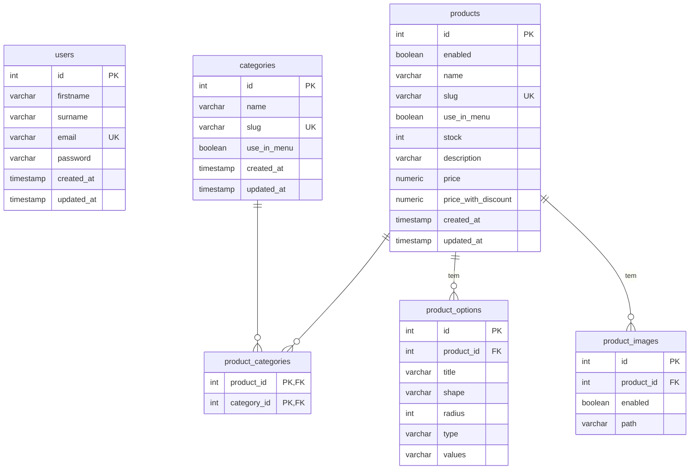

# 03 — Banco de dados

## Princípios

- O schema é definido **somente por migrations Flyway** (`src/main/resources/db/migration`).
  O Hibernate roda com `ddl-auto: validate`: se a entidade divergir da tabela, a aplicação não sobe.
- Migration aplicada **nunca é editada**. Mudança de schema = nova migration (`V7__...sql`).
- Nomes de tabela no plural e snake_case; colunas exatamente como o enunciado pede.

## Modelo entidade-relacionamento



`users` não se relaciona com as demais tabelas (o enunciado não liga produtos a usuários).

## Migrations

### `V1__create_users.sql`

```sql
CREATE TABLE users (
    id          INTEGER GENERATED BY DEFAULT AS IDENTITY PRIMARY KEY,
    firstname   VARCHAR(100) NOT NULL,
    surname     VARCHAR(100) NOT NULL,
    email       VARCHAR(150) NOT NULL,
    password    VARCHAR(255) NOT NULL,  -- hash bcrypt (60 caracteres)
    created_at  TIMESTAMP    NOT NULL DEFAULT CURRENT_TIMESTAMP,
    updated_at  TIMESTAMP    NOT NULL DEFAULT CURRENT_TIMESTAMP,
    CONSTRAINT uk_users_email UNIQUE (email)
);
```

### `V2__create_categories.sql`

```sql
CREATE TABLE categories (
    id          INTEGER GENERATED BY DEFAULT AS IDENTITY PRIMARY KEY,
    name        VARCHAR(100) NOT NULL,
    slug        VARCHAR(100) NOT NULL,
    use_in_menu BOOLEAN      NOT NULL DEFAULT FALSE,
    created_at  TIMESTAMP    NOT NULL DEFAULT CURRENT_TIMESTAMP,
    updated_at  TIMESTAMP    NOT NULL DEFAULT CURRENT_TIMESTAMP,
    CONSTRAINT uk_categories_slug UNIQUE (slug)
);

CREATE INDEX idx_categories_use_in_menu ON categories (use_in_menu);
```

### `V3__create_products.sql`

```sql
CREATE TABLE products (
    id                  INTEGER GENERATED BY DEFAULT AS IDENTITY PRIMARY KEY,
    enabled             BOOLEAN       NOT NULL DEFAULT FALSE,
    name                VARCHAR(150)  NOT NULL,
    slug                VARCHAR(150)  NOT NULL,
    use_in_menu         BOOLEAN       NOT NULL DEFAULT FALSE,
    stock               INTEGER       NOT NULL DEFAULT 0,
    description         VARCHAR(1000),
    price               NUMERIC(10,2) NOT NULL,
    price_with_discount NUMERIC(10,2) NOT NULL,
    created_at          TIMESTAMP     NOT NULL DEFAULT CURRENT_TIMESTAMP,
    updated_at          TIMESTAMP     NOT NULL DEFAULT CURRENT_TIMESTAMP,
    CONSTRAINT uk_products_slug UNIQUE (slug),
    CONSTRAINT ck_products_stock CHECK (stock >= 0),
    CONSTRAINT ck_products_price CHECK (price >= 0 AND price_with_discount >= 0)
);

CREATE INDEX idx_products_price ON products (price);  -- filtro price-range
```

### `V4__create_product_images.sql`

```sql
CREATE TABLE product_images (
    id          INTEGER GENERATED BY DEFAULT AS IDENTITY PRIMARY KEY,
    product_id  INTEGER      NOT NULL REFERENCES products (id) ON DELETE CASCADE,
    enabled     BOOLEAN      NOT NULL DEFAULT FALSE,
    path        VARCHAR(255) NOT NULL   -- relativo ao UPLOAD_DIR, ex.: products/1/3f2a...png
);

CREATE INDEX idx_product_images_product_id ON product_images (product_id);
```

> O enunciado não marca `product_id` como obrigatório aqui, mas imagem sem produto não faz sentido: `NOT NULL`.

### `V5__create_product_options.sql`

```sql
CREATE TABLE product_options (
    id          INTEGER GENERATED BY DEFAULT AS IDENTITY PRIMARY KEY,
    product_id  INTEGER      NOT NULL REFERENCES products (id) ON DELETE CASCADE,
    title       VARCHAR(100) NOT NULL,
    shape       VARCHAR(10)  NOT NULL DEFAULT 'square',
    radius      INTEGER      NOT NULL DEFAULT 0,
    type        VARCHAR(10)  NOT NULL DEFAULT 'text',
    "values"    VARCHAR(255) NOT NULL,  -- palavra reservada: sempre entre aspas
    CONSTRAINT ck_product_options_shape CHECK (shape IN ('square', 'circle')),
    CONSTRAINT ck_product_options_type  CHECK (type  IN ('text', 'color')),
    CONSTRAINT ck_product_options_radius CHECK (radius >= 0)
);

CREATE INDEX idx_product_options_product_id ON product_options (product_id);
```

**Alternativa com ENUM nativo** (se o avaliador exigir o tipo ENUM literalmente):

```sql
CREATE TYPE option_shape AS ENUM ('square', 'circle');
CREATE TYPE option_type  AS ENUM ('text', 'color');
-- e na tabela: shape option_shape NOT NULL DEFAULT 'square', ...
```

No Java, mapear com `@JdbcType(PostgreSQLEnumJdbcType.class)` e constantes do enum em minúsculo.
A abordagem `VARCHAR + CHECK` é a padrão destas specs (decisão D5).

### `V6__create_product_categories.sql`

```sql
CREATE TABLE product_categories (
    product_id  INTEGER NOT NULL REFERENCES products (id)   ON DELETE CASCADE,
    category_id INTEGER NOT NULL REFERENCES categories (id) ON DELETE CASCADE,
    PRIMARY KEY (product_id, category_id)
);

-- A PK já indexa (product_id, category_id); este índice atende buscas por categoria
CREATE INDEX idx_product_categories_category_id ON product_categories (category_id);
```

### Seed opcional (somente desenvolvimento)

Para facilitar a demonstração, criar `src/main/resources/db/seed/V100__seed.sql` com algumas
categorias e produtos, habilitado só no perfil `dev`:

```yaml
# application-dev.yml
spring:
  flyway:
    locations: classpath:db/migration,classpath:db/seed
```

Não fazer seed de usuário com senha fixa no SQL: crie o usuário via `POST /v1/user`.

## Mapeamento JPA

| Tabela | Entidade | Observações |
|---|---|---|
| `users` | `User` | `@Table(name = "users")`; `@CreationTimestamp createdAt`, `@UpdateTimestamp updatedAt` |
| `categories` | `Category` | timestamps iguais a `User` |
| `products` | `Product` | `BigDecimal price`; relacionamentos abaixo |
| `product_images` | `ProductImage` | `@ManyToOne(fetch = LAZY) Product product` |
| `product_options` | `ProductOption` | `@Column(name = "\"values\"") String values`; converters para `shape`/`type` |
| `product_categories` | — | tabela de junção via `@ManyToMany` + `@JoinTable` |

```java
/** Produto da loja. Imagens e opções pertencem ao produto e são removidas junto com ele. */
@Entity
@Table(name = "products")
public class Product {

    @Id
    @GeneratedValue(strategy = GenerationType.IDENTITY)
    private Integer id;

    @Column(nullable = false)
    private Boolean enabled = false;

    @Column(nullable = false, length = 150)
    private String name;

    @Column(nullable = false, length = 150, unique = true)
    private String slug;

    @Column(name = "use_in_menu", nullable = false)
    private Boolean useInMenu = false;

    @Column(nullable = false)
    private Integer stock = 0;

    @Column(length = 1000)
    private String description;

    @Column(nullable = false, precision = 10, scale = 2)
    private BigDecimal price;

    @Column(name = "price_with_discount", nullable = false, precision = 10, scale = 2)
    private BigDecimal priceWithDiscount;

    @OneToMany(mappedBy = "product", cascade = CascadeType.ALL, orphanRemoval = true)
    private List<ProductImage> images = new ArrayList<>();

    @OneToMany(mappedBy = "product", cascade = CascadeType.ALL, orphanRemoval = true)
    private List<ProductOption> options = new ArrayList<>();

    @ManyToMany
    @JoinTable(name = "product_categories",
               joinColumns = @JoinColumn(name = "product_id"),
               inverseJoinColumns = @JoinColumn(name = "category_id"))
    private Set<Category> categories = new HashSet<>();

    @CreationTimestamp
    @Column(name = "created_at", nullable = false, updatable = false)
    private LocalDateTime createdAt;

    @UpdateTimestamp
    @Column(name = "updated_at", nullable = false)
    private LocalDateTime updatedAt;

    // getters/setters (ou @Getter/@Setter do Lombok)
}
```

Converter de enum (o banco guarda minúsculo, o Java usa constantes em maiúsculo):

```java
public enum OptionShape { SQUARE, CIRCLE }

/** Converte OptionShape <-> 'square' | 'circle' na coluna product_options.shape. */
@Converter(autoApply = true)
public class OptionShapeConverter implements AttributeConverter<OptionShape, String> {
    public String convertToDatabaseColumn(OptionShape v) { return v == null ? null : v.name().toLowerCase(); }
    public OptionShape convertToEntityAttribute(String v) { return v == null ? null : OptionShape.valueOf(v.toUpperCase()); }
}
```

Para o JSON aceitar/devolver `"square"`, anotar as constantes com `@JsonProperty("square")` ou
usar `@JsonValue`/`@JsonCreator` no enum.

## Consultas eficientes (critério "Database Design")

| Problema | Solução |
|---|---|
| N+1 ao montar a lista de produtos (imagens, opções, categorias por produto) | `hibernate.default_batch_fetch_size: 50`: o Hibernate carrega as coleções de 50 produtos em uma query `IN (...)` |
| Paginação + `JOIN FETCH` de coleção (Hibernate pagina em memória — aviso `HHH90003004`) | **Não** usar fetch join na busca paginada; usar o batch fetch acima |
| Filtro por categoria duplica linhas e quebra o `total` | Usar `EXISTS (subquery)` na `Specification` em vez de `JOIN` + `DISTINCT` |
| Filtro `price-range` | Índice `idx_products_price` |
| Filtro `category_ids` | Índice `idx_product_categories_category_id` |
| Busca de categoria/produto por slug, usuário por email | Constraints `UNIQUE` já criam índice |
| Excluir produto com imagens/opções/categorias | `ON DELETE CASCADE` no banco + `orphanRemoval` no JPA |
| `match` com `ILIKE '%termo%'` não usa índice B-tree | Aceitável para o volume do projeto. Melhoria opcional: extensão `pg_trgm` + índice GIN em `name` e `description` |
| Conexão aberta durante a serialização | `spring.jpa.open-in-view: false`; DTOs montados dentro do service transacional |

## Critérios de aceite

- [ ] As 6 migrations aplicam sem erro em banco vazio e a aplicação sobe com `ddl-auto: validate`.
- [ ] `\d product_options` no psql mostra os `CHECK` de `shape` e `type`.
- [ ] Inserir `shape = 'triangle'` direto no banco falha.
- [ ] Excluir um produto remove suas linhas em `product_images`, `product_options` e `product_categories`.
- [ ] Excluir uma categoria remove apenas os vínculos em `product_categories`; os produtos permanecem.
- [ ] Inserir dois usuários com o mesmo email falha na constraint `uk_users_email`.
