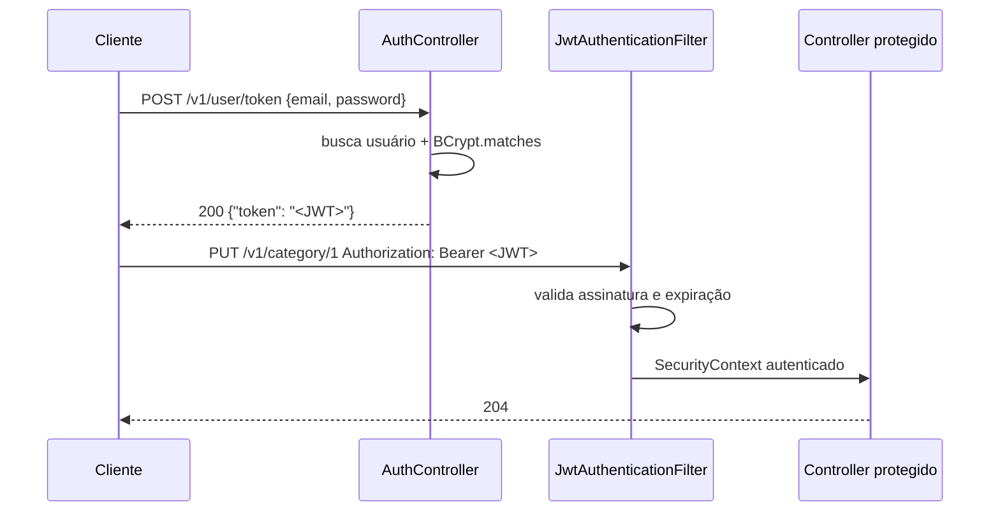

# 04 — Autenticação JWT

## Visão geral



- API **stateless**: sem sessão, sem cookie, CSRF desabilitado.
- Algoritmo **HS256**, chave lida de `app.jwt.secret` (≥ 32 caracteres; spec 02).
- Expiração: `app.jwt.expiration-minutes` (padrão 60).

## Rotas públicas e protegidas

| Método | Rota | Acesso |
|---|---|---|
| `POST` | `/v1/user` | **Público** (cadastro — decisão D2) |
| `POST` | `/v1/user/token` | **Público** (login — decisão D2) |
| `GET` | `/v1/**` | Público |
| `GET` | `/media/**` | Público (imagens de produto) |
| `*` | `/swagger-ui/**`, `/swagger-ui.html`, `/v3/api-docs/**` | Público |
| `*` | `/error` | Público (senão erros internos viram 401) |
| `POST`, `PUT`, `DELETE` | demais rotas `/v1/**` | **Requer** `Authorization: Bearer <jwt>` |

Sem token, token malformado, assinatura inválida ou expirado → **401** (decisão D1).

## Endpoint — `POST /v1/user/token`

**Headers:** `Content-Type: application/json`

**Payload**

```json
{ "email": "user@mail.com", "password": "123@123" }
```

**Validação**

| Campo | Regra |
|---|---|
| `email` | obrigatório, formato de email |
| `password` | obrigatório |

**Comportamento**

1. Normaliza o email (`trim().toLowerCase()`) e busca o usuário.
2. Se não existir **ou** `passwordEncoder.matches(...)` for falso → `BadRequestException("E-mail ou senha inválidos")`.
3. Gera o token com `sub` = id do usuário e claim `email`.

**Resposta 200**

```json
{ "token": "eyJhbGciOiJIUzI1NiJ9..." }
```

| Status | Quando |
|---|---|
| 200 | Credenciais corretas |
| 400 | Campo ausente/inválido ou credenciais incorretas (decisão D3) |

## Claims do token

```json
{ "sub": "1", "email": "user@mail.com", "iat": 1731440000, "exp": 1731443600 }
```

## Componentes

### `JwtService`

```java
/** Gera e valida tokens JWT assinados com HS256. */
@Service
public class JwtService {
    private final SecretKey key;
    private final long expirationMinutes;

    public JwtService(AppProperties props) {
        this.key = Keys.hmacShaKeyFor(props.jwt().secret().getBytes(StandardCharsets.UTF_8));
        this.expirationMinutes = props.jwt().expirationMinutes();
    }

    public String generate(User user) {
        Instant now = Instant.now();
        return Jwts.builder()
                .subject(user.getId().toString())
                .claim("email", user.getEmail())
                .issuedAt(Date.from(now))
                .expiration(Date.from(now.plus(expirationMinutes, ChronoUnit.MINUTES)))
                .signWith(key)
                .compact();
    }

    /** Retorna as claims se o token for válido; lança JwtException caso contrário. */
    public Claims parse(String token) {
        return Jwts.parser().verifyWith(key).build().parseSignedClaims(token).getPayload();
    }
}
```

### `JwtAuthenticationFilter` (`OncePerRequestFilter`) — equivalente ao middleware do Express

1. Lê o header `Authorization`. Se ausente ou sem prefixo `Bearer `, segue a cadeia sem autenticar
   (o Spring Security devolve 401 se a rota for protegida).
2. Faz `jwtService.parse(token)`. Em `JwtException`, segue sem autenticar.
3. Se válido, coloca um `UsernamePasswordAuthenticationToken(userId, null, List.of())` no
   `SecurityContextHolder`.

### `SecurityConfig`

```java
@Bean
SecurityFilterChain securityFilterChain(HttpSecurity http) throws Exception {
    return http
        .csrf(AbstractHttpConfigurer::disable)
        .sessionManagement(s -> s.sessionCreationPolicy(SessionCreationPolicy.STATELESS))
        .authorizeHttpRequests(auth -> auth
            .requestMatchers(HttpMethod.POST, "/v1/user", "/v1/user/token").permitAll()
            .requestMatchers(HttpMethod.GET, "/v1/**", "/media/**").permitAll()
            .requestMatchers("/swagger-ui/**", "/swagger-ui.html", "/v3/api-docs/**", "/error").permitAll()
            .anyRequest().authenticated())
        .exceptionHandling(e -> e.authenticationEntryPoint(jsonAuthenticationEntryPoint))
        .addFilterBefore(jwtAuthenticationFilter, UsernamePasswordAuthenticationFilter.class)
        .build();
}

@Bean
PasswordEncoder passwordEncoder() { return new BCryptPasswordEncoder(); }
```

Desabilitar o usuário padrão gerado pelo Spring Security (log "Using generated security password")
registrando um `UserDetailsService` vazio ou excluindo `UserDetailsServiceAutoConfiguration`.

### `JsonAuthenticationEntryPoint`

Implementa `AuthenticationEntryPoint` e escreve status 401 + `ErrorResponse` (spec 05) com a
mensagem `"Token de autenticação ausente ou inválido"`.

## Critérios de aceite

- [ ] `POST /v1/user/token` com credenciais corretas → 200 com `token`.
- [ ] Senha errada → 400; email inexistente → 400 com **a mesma** mensagem.
- [ ] `POST /v1/category` sem header → 401 com corpo JSON.
- [ ] `POST /v1/category` com `Bearer abc` → 401.
- [ ] `POST /v1/category` com token expirado → 401 (testar com expiração de 0 min ou token gerado com data passada).
- [ ] `POST /v1/category` com token válido → 201.
- [ ] `GET /v1/category/search` e `POST /v1/user` funcionam sem token.
- [ ] Swagger UI abre sem token e o botão **Authorize** aceita o JWT.
