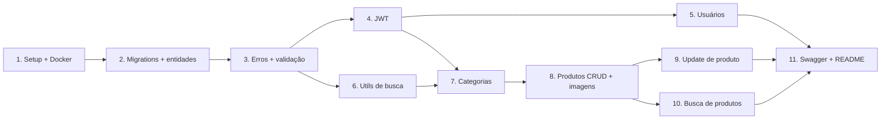

# 11 — Roadmap de implementação

Hoje é **qui 12/11/2026** e a entrega é **sex 20/11/2026**: são 8 dias de trabalho (contando o fim de semana).
A ordem abaixo segue as dependências: cada etapa usa o que a anterior deixou pronto.

## Ordem das etapas

| # | Etapa | Spec | Pronto quando |
|---|---|---|---|
| 1 | Projeto no Initializr, Git/GitHub, Dockerfile, compose, `.env.example`, `application.yml` | 01, 02 | `docker compose up --build` sobe banco e API |
| 2 | Migrations V1–V6 e entidades JPA | 03 | Aplicação sobe com `ddl-auto: validate` |
| 3 | `ErrorResponse`, exceções, `GlobalExceptionHandler` | 05 | JSON malformado → 400 no formato padrão |
| 4 | `JwtService`, filtro, `SecurityConfig`, `POST /v1/user/token` | 04 | Rota protegida sem token → 401 JSON |
| 5 | CRUD de usuários | 06 | Critérios de aceite da spec 06 com testes |
| 6 | `SearchParams`, `FieldSelector`, `PageResponse` | 05, 07 | Testes unitários passando |
| 7 | CRUD + busca de categorias | 07 | Critérios de aceite da spec 07 |
| 8 | Produto: POST, GET por id, DELETE, `ImageStorageService`, `/media/**` | 08 | Imagem enviada em base64 abre no navegador |
| 9 | Produto: PUT com operações de imagens/opções/categorias | 08 | Payload do enunciado → 204 com todos os efeitos |
| 10 | Produto: busca com todos os filtros | 08 | Critérios de aceite de busca da spec 08 |
| 11 | Anotações Swagger, README, comentários, revisão final | 10 | Critérios da spec 10 |

## Plano por dia

| Dia | Data | Etapas | Observação |
|---|---|---|---|
| 1 | qui 12/11 | 1, 2 | Repositório no GitHub criado hoje, todos com acesso |
| 2 | sex 13/11 | 3, 4, 5 | — |
| 3 | sáb 14/11 | 6, 7 | — |
| 4 | dom 15/11 | 8 | — |
| 5 | seg 16/11 | 9 | Monitoria 18h30–22h30: levar dúvidas da etapa 9 |
| 6 | ter 17/11 | 10 | Monitoria 19h30–21h30 |
| 7 | qua 18/11 | 11 | Monitoria 19h30–21h30 |
| 8 | qui 19/11 | Folga para atrasos; clonar o repo em outra máquina e seguir o README do zero | Última monitoria antes da entrega |
| 9 | sex 20/11 | **Entrega**: link do repositório + nomes da equipe | — |

## Divisão para equipe de 3

Depois do dia 1 (feito em conjunto), três frentes podem andar em paralelo:

| Pessoa | Frente | Etapas |
|---|---|---|
| A | Infra, segurança e usuários | 3, 4, 5, 11 (README) |
| B | Utilidades de busca, categorias e base de testes | 6, 7, `IntegrationTestBase` (spec 09) |
| C | Produtos | 8, 9, 10 |

- B entrega a etapa 6 cedo (dia 2), porque C precisa dela na etapa 10.
- C pode começar a etapa 8 assumindo que o 401 vem do Spring Security, antes de A terminar a etapa 4.
- Cada frente em sua branch (`feat/usuarios`, `feat/categorias`, `feat/produtos`) com Pull Request para `main`,
  revisado por outra pessoa da equipe. O histórico de PRs também conta como evidência de organização.

Sugestão de mensagens de commit: `feat: cria endpoint de busca de categorias`,
`fix: retorna 404 ao excluir produto inexistente`, `docs: adiciona guia de setup`, `test: ...`.

## Checklist final (critérios de avaliação)

**Funcionalidades essenciais**
- [ ] 15 endpoints implementados (spec 00, "Escopo funcional")
- [ ] CRUD completo de usuários, categorias e produtos
- [ ] JWT em POST/PUT/DELETE, com as exceções D2
- [ ] Status HTTP corretos (200, 201, 204, 400, 401, 404) e erros em JSON padrão

**Qualidade do código**
- [ ] Camadas controller → service → repository respeitadas; nenhuma entidade na resposta
- [ ] Javadoc nas classes e métodos públicos
- [ ] Sem segredo no código; sem código comentado/morto; sem `System.out.println`

**Banco de dados**
- [ ] 6 migrations Flyway; `ddl-auto: validate`
- [ ] FKs com `ON DELETE CASCADE`, `UNIQUE`, `CHECK` e índices da spec 03
- [ ] Busca de produtos sem N+1 e sem duplicação no `total`

**Documentação**
- [ ] Swagger com todos os endpoints, status e autenticação
- [ ] README com setup via Docker, uso da API, decisões de projeto e nomes da equipe

**Entrega**
- [ ] Repositório público (ou com acesso aos avaliadores) no GitHub
- [ ] Clone limpo + `cp .env.example .env` + `docker compose up --build` funciona
- [ ] `./mvnw test` passa
